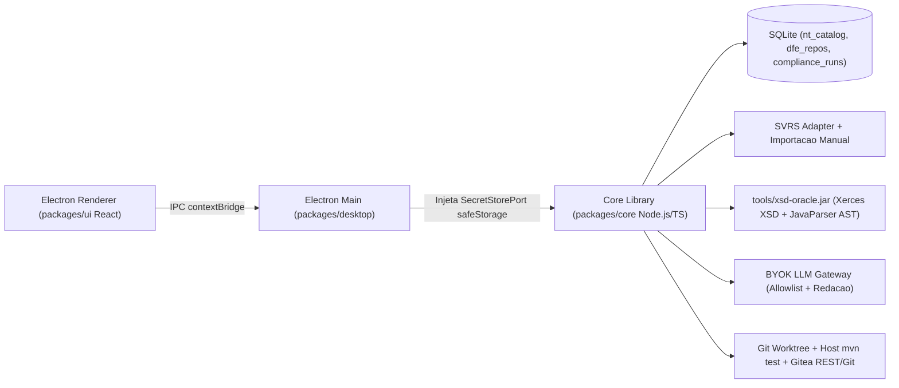
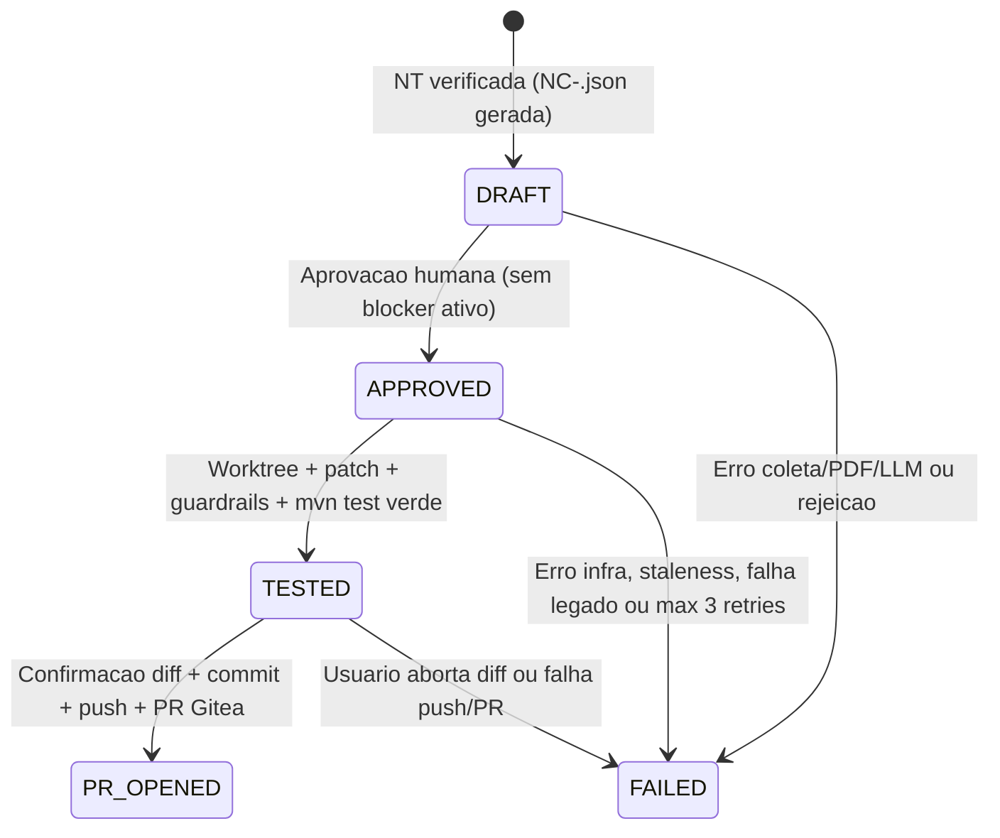

# NT Conformidade — Validação e Adequação Estrutural de Parsers DFe

*   **Author:** Willy Garabini Cornelissen
*   **Status:** Proposed
*   **Date:** 2026-11-19

--------------------------------------------------------------------------------

## Overview

O **NT Conformidade** é uma aplicação desktop (testada inicialmente em WSL2/Linux com meta de execução em Windows, construída sobre um núcleo TypeScript headless reutilizável no futuro para CLI e aplicação web) para manter os parsers Java 8 dos 8 documentos fiscais eletrônicos (**DFe**): Nota Fiscal Eletrônica (**NFe**), Bilhete de Passagem Eletrônico (**BPe**), Manifesto Eletrônico de Documentos Fiscais (**MDFe**), Conhecimento de Transporte Eletrônico (**CTe**), Nota Fiscal de Energia Elétrica Eletrônica (**NF3e**), Nota Fiscal Fatura de Serviços de Comunicação Eletrônica (**NFCom**), Guia de Transporte de Valores Eletrônica (**GTVe**) e Nota Fiscal de Consumidor Eletrônica (**NFCe**) estruturalmente alinhados às Notas Técnicas (**NTs**) publicadas no portal da Sefaz Virtual do Rio Grande do Sul ([SVRS](https://dfe-portal.svrs.rs.gov.br/)).

O sistema exibe as últimas NTs e datas por documento fiscal, executa análise estrutural de conformidade contra o repositório correspondente no Gitea (`https://gitea.apps.ticio.fazenda.mg.gov.br/Integracao/...`), gera uma Nota de Conformidade editável (`NC-<NT>`) e, após aprovação humana, aplica as alterações no parser e nos testes unitários JUnit 5 em um workspace isolado, executa `mvn test` após conferência do diff e abre branch, commits e Pull Request (PR) no Gitea.

## The Problem

Hoje o acompanhamento de Notas Técnicas das Secretarias de Fazenda (**SEFAZ**) e a atualização dos 8 repositórios de parsers ocorrem manualmente, sem automação:

1. **Monitoramento disperso:** A equipe precisa consultar manualmente páginas do portal SVRS para descobrir novas NTs, versões revisadas (`v1.00`, `v1.10`) e pacotes de esquema XML (**XSD**) atualizados para 8 documentos fiscais diferentes.
2. **Análise manual propensa a omissões:** Cada parser segue o modelo do `nfe-parser` (`br.gov.mg.fazenda:nfe-parser:2.1.5`), uma biblioteca Java 8 pura com Project Lombok e Jackson Annotations dividida em quatro pacotes Java (`parser/`, `mapper/`, `<dfe>/` — por exemplo, `nfe/` — e `table/`, além de utilitários opcionais em `util/` como `Cnpj`). Os parsers usam leitura baseada em eventos SAX e a biblioteca compartilhada `br.gov.mg.fazenda:xml-parser` para converter XMLs em elementos indexados por caminho completo da tag em caixa alta (`tagPath`, ex.: `NFEPROC.NFE.INFNFE.IDE.CUF`), mapear campos para DTOs de domínio (`<dfe>/`) com `@JsonProperty` (que preservam os nomes JSON enviados ao tópico Kafka, como `catalogo.nfe.json` no `nfe-parser`) e achatá-los em modelos tabulares (`table/`, via `Default*TableParser`). Alguns repositórios ainda mantêm arquivos legados de CI do GitLab (`.gitlab-ci.yml`, `ci_settings.xml`) mesmo após migração para Gitea. Mapear manualmente dezenas de páginas de PDF de uma NT para esses quatro pacotes gera retrabalho e risco de esquecer campos ou quebrar contratos JSON/tabulares.
3. **Risco de validação circular e vazamento de dados com uso ingênuo de LLM:** Pedir diretamente a um Modelo de Linguagem Grande (**LLM**) que leia um PDF e gere código e testes pode produzir interpretações incorretas que passam em testes escritos pela própria LLM, além de expor dados fiscais reais (como `CNPJ`, `CPF` e `chave de acesso` de 44 dígitos) contidos em amostras XML de `src/test/resources/test-files/` caso payloads sejam enviados para APIs externas.

A solução proposta combina coleta com cache local de NTs/XSDs no portal SVRS, comparação determinística entre XSDs oficiais e o código Java antes de acionar a LLM, geração de uma `NC-<NT>` revisável na interface, aplicação controlada das mudanças com validação via XSD e `mvn test`, e revisão humana do diff antes de executar o build no host e abrir o PR no Gitea.

## Goals

*   Exibir na abertura da aplicação uma tabela com as últimas NTs e datas de publicação para cada um dos 8 DFes (`NFe`, `BPe`, `MDFe`, `CTe`, `NF3e`, `NFCom`, `GTVe`, `NFCe`), alimentada por cache local e sincronização em segundo plano com o [portal SVRS](https://dfe-portal.svrs.rs.gov.br/), com importação manual de PDF e XSD como contingência.
*   Manter um registro configurável associando os 8 DFes aos seus repositórios dedicados no Gitea (`https://gitea.apps.ticio.fazenda.mg.gov.br/Integracao/...`), branch base, pacotes alvo e versão base de NT/XSD implementada.
*   Executar verificação de conformidade estrutural combinando comparação determinística (XSD oficial vs. mapeamentos Java nos pacotes `mapper/`, `<dfe>/` e `table/`) e análise por LLM para gerar um contrato estruturado `NC-<NT>` revisável (incluindo bloqueio explícito caso a mudança exija alteração na biblioteca compartilhada `br.gov.mg.fazenda:xml-parser`).
*   Aplicar somente `NC-<NT>` aprovadas por humanos em um `git worktree` isolado, atualizando código compatível com Java 8 (`mapper/`, `<dfe>/`, `table/`) e criando/atualizando testes unitários JUnit 5 obrigatórios com XMLs sintéticos em `src/test/resources/synthetic/` validados contra o XSD oficial (`SchemaFactory`).
*   Exigir que 100% da suíte `mvn test` (incluindo os arquivos locais existentes em `src/test/resources/test-files/`) passe antes de liberar commit, push e PR no Gitea, excluindo `src/test/resources/test-files/**` do contexto enviado a LLMs externas e aplicando sanitização em logs de erro de build/teste.
*   Implementar um gateway de LLM no padrão **BYOK (Bring Your Own Key)** permitindo especificar provedor, modelo, nome do operador para auditoria e o token do usuário (suportando provedores de API key direta — `Gemini` e endpoints compatíveis com `OpenAI` — além de adaptador isolado para modelos do plano `GitHub Copilot`).
*   Manter o núcleo de domínio (`packages/core`) sem dependências de interface gráfica para viabilizar reutilização futura em ferramenta de linha de comando (**CLI**) e aplicação web, conectando a UI desktop da v1 diretamente via comunicação entre processos (**IPC**) do Electron.

## Non-Goals

*   Implementar regras de validação semântica ou de autorização cruzada da SEFAZ (códigos de status `cStat` e rejeições de negócio) dentro do código dos parsers na v1 — essas regras são apenas listadas em seção informativa da `NC-<NT>`.
*   Introduzir Spring Framework ou bibliotecas não aprovadas nos repositórios de parsers Java 8, ou alterar automaticamente `pom.xml`, `.gitlab-ci.yml`, `ci_settings.xml` e versões de release no Sonatype Nexus.
*   Fazer merge automático de PRs, push direto na branch principal ou enviar código para o Gitea sem aprovação humana da `NC-<NT>` e revisão do diff gerado.
*   Enviar arquivos XML reais de `src/test/resources/test-files/` para provedores externos de LLM ou enviar falhas de testes legados para retentativa automática da LLM.
*   Realizar transmissões para webservices de homologação ou produção da SEFAZ com certificado digital A1/A3 na v1.
*   Construir daemon HTTP/SSE em `127.0.0.1` ou CLI completa de produção na v1 (reservados para a etapa futura de CLI e Web App).

## Open Questions

*   **Questão Aberta 1 (`GitHubCopilotAdapter` — B2 escalado):** Confirmar qual fluxo de autenticação e endpoint está habilitado no ambiente corporativo para o uso em runtime dos modelos do plano GitHub Copilot — **GitHub Models** (via Personal Access Token — `PAT` do GitHub) ou **GitHub Copilot SDK / OAuth Device Flow** vinculado à licença corporativa — bem como seus limites de janela de contexto e cota.

## Critical User Journeys (CUJs)

### CUJ 1: Consultar últimas Notas Técnicas na inicialização

*   **Given**: O usuário inicia a aplicação desktop (com cache local disponível e acesso opcional à rede para consultar o portal SVRS).
*   **When**: A tela inicial carrega a tabela dos 8 DFes (`NFe`, `BPe`, `MDFe`, `CTe`, `NF3e`, `NFCom`, `GTVe`, `NFCe`).
*   **Then**: O sistema exibe os dados em cache com data da última sincronização sem bloquear na rede, dispara atualização em segundo plano do portal SVRS (agrupando versões e erratas por NT), sinaliza eventuais falhas de coleta apenas para o DFe afetado e permite selecionar qualquer NT ou importar manualmente um par PDF + pacote XSD.

### CUJ 2: Verificar conformidade estrutural e gerar `NC-<NT>` revisável

*   **Given**: O usuário selecionou um DFe, uma NT alvo e o repositório Gitea correspondente configurado no registro do aplicativo, e o ambiente possui acesso ao repositório e aos arquivos da NT (PDF/XSD).
*   **When**: O usuário aciona a ação "Verificar conformidade".
*   **Then**: O núcleo atualiza o clone local da branch base, extrai o inventário atual de mapeamentos Java (`tagPath`/tags mapeadas, DTOs `@JsonProperty` e campos `*Table`), compara deterministicamente com o XSD oficial da NT (quando disponível), aciona o gateway BYOK apenas sobre código-fonte filtrado, diff XSD e trechos da NT (sem payloads de `test-files/`) e grava o contrato `NC-<NT>.json` (com visualização `NC-<NT>.md` gerada em mão única), separando alterações estruturais acionáveis de regras semânticas apenas informativas e marcando bloqueios em `xml-parser`.

### CUJ 3: Revisar `NC-<NT>`, revisar diff, validar com `mvn test` e abrir PR no Gitea

*   **Given**: Existe uma `NC-<NT>.json` gerada e o desenvolvedor revisou, ajustou itens e aprovou sua aplicação (sem itens `SHARED_XML_PARSER_BLOCKER` ativos).
*   **When**: O usuário aciona "Aplicar NC ao parser".
*   **Then**: O sistema cria um `git worktree` isolado e uma branch determinística (`nc/<dfe>-<nt_number>-<nt_version>`), gera as alterações propostas para os pacotes `mapper/`, `<dfe>/`, `table/` e os novos testes unitários JUnit 5 com XMLs sintéticos em `src/test/resources/synthetic/` validados pelo XSD oficial, exibe o diff gerado para conferência de segurança antes do build (salvo aprovação explícita para alterações estritamente declarativas), executa `mvn test` uma única vez (incluindo os `test-files/` locais), apresenta o diff final e o relatório Surefire e, após confirmação do usuário, realiza commit, push e abertura do PR no Gitea vinculando `NC-<NT>.md`.

### CUJ 4: Falha de build/teste, limite de tentativas ou indisponibilidade de infraestrutura

*   **Given**: Uma aplicação de `NC-<NT>` está em andamento e ocorre erro de compilação Java 8, falha em teste JUnit 5, erro de resolução no Nexus ou indisponibilidade de rede/Gitea.
*   **When**: O executor analisa a saída do `mvn test` e os relatórios `target/surefire-reports/TEST-*.xml`.
*   **Then**: Em erros de infraestrutura (Nexus, JDK, Gitea), ou em falhas em testes legados que leem `test-files/**`, o sistema interrompe imediatamente sem acionar retentativa da LLM (`FAILED`) para preservar privacidade e evitar gasto de tokens; em erros de compilação ou falhas exclusivas da nova classe de teste sintética, executa até 3 tentativas de correção sanitizadas; se esgotar tentativas ou for abortado, exporta o arquivo `.patch` local como artefato de diagnóstico, limpa o worktree temporário e não faz push nem abre PR.

## Technical Plan (Architecture)

### 1. Visão Geral da Arquitetura (Núcleo Headless + Casca Electron)

O sistema é estruturado em um monorepo TypeScript/Node.js dividido em três pacotes principais (`packages/core`, `packages/ui`, `packages/desktop`) além de um utilitário CLI Java local (`tools/xsd-oracle`), mantendo o núcleo livre de acoplamento com interface gráfica:

1. **Núcleo Headless (`packages/core`):** Biblioteca TypeScript executada em Node.js com persistência local em **SQLite** (3 tabelas de cache/índice). Expõe serviços assíncronos tipados e eventos de progresso, isolando dependências externas atrás de quatro fronteiras principais (`NtSourcePort`, `OracleAnalyzerPort`, `LlmGatewayPort`, `GitMavenForgePort`) mais `SecretStorePort` injetado pelo processo hospedeiro.
2. **Utilitário Java Local (`tools/xsd-oracle`):** CLI Java empacotada em `xsd-oracle.jar` executada sobre o JDK já exigido pelo host. Centraliza tanto a extração/validação oficial de XSDs (`xerces:xercesImpl` + `SchemaFactory`) quanto a análise sintática exata dos parsers Java (`JavaParser`), eliminando addons nativos C++ de `tree-sitter` do empacotamento Electron.
3. **Interface Desktop (`packages/desktop` e `packages/ui`):** Aplicação **Electron** (Chromium + Node.js) renderizando a interface React/Vite (`packages/ui`). Na v1, `packages/ui` conversa diretamente com `packages/core` via Electron `ipcMain` / `contextBridge` (sem daemon HTTP em `127.0.0.1` nem CLI completa), enquanto o processo principal do Electron injeta o adaptador de segredos `Electron safeStorage` dentro de `packages/core` sem nunca retornar tokens em texto claro para o renderer. A mesma `packages/ui` e o mesmo `packages/core` permanecem prontos para futuros adaptadores CLI e Web.

### 2. Fluxo e Máquina de Estados de Execução

Cada execução no SQLite é rastreada por `run_id` e chave lógica `(dfe, nt_number, nt_version)` com cinco estados persistidos, registrando falhas de qualquer etapa uniformemente em `{ status, failed_step, error_message }`:

*(Quando o diff determinístico XSD × AST não encontra lacunas estruturais e o usuário confirma, a `NC-<NT>.json` registra conformidade sem necessidade de patch.)*

### 3. Componentes e Contratos Técnicos

#### A. Coletor SVRS e Cache Local (`svrs-adapter`)
* **Mecanismo:** Consultas assíncronas ao [portal SVRS](https://dfe-portal.svrs.rs.gov.br/) por DFe em segundo plano após a abertura da UI, normalizando cada publicação em `(dfe, nt_number, nt_version, published_date, homolog_date, prod_date, pdf_url, xsd_url, sha256)` no SQLite.
* **Resiliência:** A tabela inicial carrega a partir do cache SQLite sem bloquear na rede. Falhas ou mudanças de HTML isolam o aviso apenas no DFe afetado e habilitam importação manual de `PDF + pacote XSD`.

#### B. Registro dos 8 Repositórios e Diagnóstico de Ambiente (`dfe-registry` + `doctor`)
* **Registro configurável:** Mapeia os 8 DFes (`NFe`, `BPe`, `MDFe`, `CTe`, `NF3e`, `NFCom`, `GTVe`, `NFCe`) para suas URLs no Gitea (`https://gitea.apps.ticio.fazenda.mg.gov.br/Integracao/<repo>`, incluindo `nfce-parser` separado de `nfe-parser`), branch base, `domainPackage`, `utilPackage` opcional (`util/Cnpj.java`), `mapperPackage`, `tablePackage`, prefixo de normalização (ex.: `NFEPROC` no `nfe-parser`) e versão base de NT/XSD.
* **Diagnóstico enxuto (`doctor`):** Como o `mvn test` roda **nativamente no host**, `doctor` verifica: JDK instalado (alertando incompatibilidade de Lombok `1.18.30` em JDK 21+ e garantindo `-Dmaven.compiler.release=8` quando JDK >= 9), executável `mvn`/`mvn.cmd`, `git` configurado com `core.autocrlf=input` (necessário no Windows para não poluir diffs contra repositórios Linux/Gitea com `CRLF`), resolução real das dependências do `pom.xml` alvo via host Maven / cache `~/.m2/repository` e conectividade com Gitea e endpoint LLM configurado.

#### C. Oráculo Determinístico Consolidado (`tools/xsd-oracle.jar`)
* **Extração e Validação XSD (`xerces:xercesImpl` + `SchemaFactory`):** Usa `XMLConstants.FEATURE_SECURE_PROCESSING`, `LSResourceResolver` restrito a arquivos locais (bloqueando chamadas externas contra XXE/SSRF) e limite de profundidade para recursões em `<xs:include>`/`<xs:import>`. Emite árvore canônica (`tagPath` em caixa alta, atributos como `.ATTR`, `xsdType`, `minOccurs`, `maxOccurs`) e valida XMLs sintéticos antes dos testes do parser.
* **Indexação AST Java (`JavaParser`):** Substitui `tree-sitter-java` e extrai do código Java: (1) todas as chaves `.put(...)` de mapas `static final Map<String, BiConsumer<..., String>>` independentemente do nome do campo (`NFE_FIELD_SETTERS`, `ICMS_SETTERS`, `PIS_FIELD_SETTERS`, `FIELD_SETTERS`), resolvendo chaves de tag folha via cadeia `XmlSearch.find*FromAncestorByTagName(...)` e filtros `getTagPath().contains(...)` (como em `PisMapper.java`), além de mappers diretos via `XmlSearch` (`NveMapper.java`); (2) campos e valores `@JsonProperty` das entidades de domínio; e (3) colunas preenchidas em `Default*TableParser`/`*Table`, ignorando campos internos de ingestão fora do XSD (ex.: `idCarga`, `endIpTransmissor`, `nrPortaOrigem`, `keyObjectStorage`).
* **Diff Estrutural:** Calcula uma lista determinística inicial identificável estaticamente (`MISSING_TAG`, `CARDINALITY_MISMATCH`, `TYPE_MISMATCH`) como âncora de entrada para a LLM.

#### D. Gateway de LLM BYOK, Política de Dados e Contrato `NC-<NT>`
* **Gateway BYOK:** Parametrizado por `(provider, model_id)` com token armazenado para o usuário do SO via `SecretStorePort` (`Electron safeStorage` no processo principal) e `operator_name` registrado apenas como metadado de auditoria em `compliance_runs`. Na v1 inclui `GeminiAdapter`, `OpenAiCompatibleAdapter` (OpenAI e endpoints compatíveis internos/locais) e `GitHubCopilotAdapter` (fluxo exato pendente da Questão Aberta 1).
* **Política de contexto e `test-files/`:** Na montagem de prompts externos, aplica allowlist estrita permitindo leitura apenas de `src/main/java/**`, `src/test/java/**`, `src/test/resources/synthetic/**`, diffs XSD × AST e trechos da NT; arquivos em `src/test/resources/test-files/**` e XMLs legados nunca são enviados a LLMs externas, permanecendo acessíveis apenas localmente para regressão do `mvn test`.
* **Fonte única `NC-<NT>.json`:** Persistida em `NTC_DATA_DIR/ncs/` (padrão `app.getPath('userData')`), contendo `nc_id`, `nt_ref` (`{ dfe, nt_number, nt_version, published_date, pdf_sha256 }`), `base_commit_sha` e itens classificados em `STRUCTURAL_MAPPER`, `STRUCTURAL_DTO`, `STRUCTURAL_TABLE`, `SHARED_XML_PARSER_BLOCKER` ou `SEMANTIC_RULE_INFO_ONLY` com decisão `APPROVE | SKIP | EDIT` editada na UI. O arquivo `NC-<NT>.md` é gerado em mão única a partir do JSON para leitura humana e corpo do PR. Itens `SHARED_XML_PARSER_BLOCKER` não marcados como `SKIP` bloqueiam `apply`.

#### E. Motor de Patch, Segurança no Host, `mvn test` e PR no Gitea
* **Isolamento e formato de patch:** Verifica se `HEAD` no Gitea não avançou desde `base_commit_sha` e cria `git worktree` descartável na branch `nc/<dfe>-<nt_number>-<nt_version>` (normalizada). A LLM emite blocos ancorados `SEARCH`/`REPLACE` para arquivos Java existentes e conteúdo completo para novas classes `*Test.java` e novos XMLs sintéticos em `src/test/resources/synthetic/`.
* **Guardrails pré-build e segurança no host:** Rejeita patches que alterem `pom.xml`, `.gitlab-ci.yml`, `ci_settings.xml`, `src/test/resources/test-files/**`, removam testes ou adicionem `@Disabled`, alterem nomes ou valores de `@JsonProperty` existentes, ou introduzam APIs bloqueadas (`java.lang.Runtime`, `ProcessBuilder`, `java.net.*`, `java.lang.reflect.*`, `javax.script.*`, `System.getenv`, escrita em disco fora de `synthetic/`). Exceto quando o usuário optar por execução direta em diffs estritamente declarativos, o diff é exibido para conferência humana antes de rodar `mvn test` no host.
* **Execução única de `mvn test` e triagem:** Executa `mvn test` uma única vez (com `-Dmaven.compiler.release=8` quando JDK >= 9 e ambiente limpo sem variáveis de segredo da aplicação). Falhas de rede/Nexus/JDK/Lombok abortam imediatamente (`FAILED`); caso contrário, inspeciona `target/surefire-reports/TEST-*.xml`: falhas em testes preexistentes que leem `test-files/**` abortam `PATCH_REPAIR` e seguem para inspeção humana sem vazar payloads; apenas erros de compilação ou falhas nas novas classes de teste sintéticas acionam até 3 retentativas sanitizadas de correção.
* **Gate final e PR:** Com `mvn test` verde, o usuário revisa o diff final e o resumo Surefire antes de executar commit, push (`GIT_ASKPASS` efêmero com Gitea PAT) e abertura do PR via API REST do Gitea.

## Alternatives Considered

### Alternativa A: Incluir geração automática de regras de validação semântica da SEFAZ na v1

*   **Pros**: Cobriria regras cruzadas de autorização e rejeição (`cStat`) descritas nas NTs além das mudanças de schema XML.
*   **Cons**: Os repositórios de parsers atuais (conforme `nfe-parser/pom.xml` e `stack-parser.md`) são bibliotecas Java 8 puras de extração estrutural (`tagPath` -> DTO `@JsonProperty` -> `*Table`), sem Spring Framework nem camada de validação. Gerar regras de rejeição dentro do mapper pode quebrar a ingestão de XMLs históricos/autorizados.
*   **Reason for Rejection**: A v1 fica restrita à conformidade estrutural, registrando regras semânticas apenas como informação na `NC-<NT>` (decisão registrada em [concepts_brief.md](../../concepts_brief.md)).

### Alternativa B: Análise e geração 100% via LLM sobre PDF e código, sem oráculo XSD determinístico

*   **Pros**: Dispensa implementar extrator de árvore XSD e validador local via `SchemaFactory`.
*   **Cons**: Cria ciclo de validação circular onde erros de interpretação da LLM em tabelas de PDF (colunas deslocadas, texto tachado, erratas) passam nos próprios testes escritos pela LLM, aumentando risco de regressão fiscal.
*   **Reason for Rejection**: O diff determinístico XSD × AST e a validação XSD dos XMLs sintéticos são obrigatórios antes e depois da LLM (decisão registrada em [concepts_brief.md](../../concepts_brief.md)).

### Alternativa C: Núcleo em Python ou Java com UI em Tauri, JavaFX ou navegador local

*   **Pros**: Python oferece bibliotecas maduras de PDF/XML e menor consumo de RAM; Java evita duas linguagens; Tauri gera binários menores no Windows.
*   **Cons**: Python exige aproximações para AST Java; JavaFX não reaproveita a UI React no futuro Web App; Tauri depende de toolchain Rust e WebKitGTK/EGL sob WSLg/WSL2.
*   **Reason for Rejection**: Escolhida a stack TypeScript/Node.js + Electron (com análise Java/XSD consolidada em `tools/xsd-oracle.jar`) para manter linguagem única entre núcleo e UI React sem dependências de WebKitGTK no WSL2.

### Alternativa D: Execução de `mvn test` em container Docker efêmero (ou via `SecurityManager`)

*   **Pros**: Isola execução de código gerado por LLM do sistema operacional do operador e elimina divergências entre WSL2 e Windows.
*   **Cons**: Docker exige daemon ativo e configuração adicional de rede para alcançar o Nexus interno; `SecurityManager` foi depreciado no JDK 17 (JEP 411) e quebra classloaders de Surefire/Lombok.
*   **Reason for Rejection**: A v1 executa `mvn test` nativamente no host com allowlist de importações Java perigosas, conferência humana pré-build e `-Dmaven.compiler.release=8`.

### Alternativa E: Delegar edição a agente CLI externo, restringir a LLM local ou acoplar apenas ao GitHub Copilot

*   **Pros**: Agente CLI externo evita manter motor de patches; LLM apenas local elimina tráfego externo; travar no GitHub Copilot simplifica autenticação.
*   **Cons**: Agente CLI externo quebra portabilidade Windows/Web e controle granular de `test-files/`; LLM local exige GPU para PDFs longos; depender apenas do GitHub Copilot bloqueia uso imediato com chaves Gemini/OpenAI.
*   **Reason for Rejection**: Escolhido o gateway BYOK multi-provedor (com adaptador isolado para GitHub Copilot) e motor próprio de patches ancorados no núcleo.

### Alternativa F: Fluxo exclusivamente CLI e Issues/PRs no Gitea sem aplicativo Desktop

*   **Pros**: Reduz custo inicial de empacotamento visual usando apenas a interface web do Gitea.
*   **Cons**: Não entrega o aplicativo desktop com tabela inicial unificada dos 8 DFes e fluxo guiado local exigidos no projeto.
*   **Reason for Rejection**: Mantido o aplicativo desktop Electron na v1, preservando o núcleo headless para CLI e Web em versões futuras.

## Non-Functional Requirements

*   **Segurança & Privacidade:** Tokens PAT do Gitea, credenciais Nexus e chaves/tokens BYOK de LLM são armazenados no cofre do sistema operacional via `Electron safeStorage` no processo principal, nunca em SQLite, arquivos do repositório ou processo renderer. Subprocessos `mvn` recebem ambiente limpo sem segredos da aplicação. Prompts externos excluem `test-files/**` e aplicam sanitização em logs de erro.
*   **Performance, Latência & Orçamento de Tokens:** A UI inicial carrega a partir do cache SQLite sem bloquear na sincronização de rede do SVRS. PDFs de NTs são segmentados e identificados por hash SHA-256 para evitar reprocessamento; apenas classes Java associadas aos `tagPath`s afetados são enviadas à LLM, respeitando limite configurável de tokens e máximo de 3 iterações de correção por execução.
*   **Compatibilidade, Rollout & Rollback:** Preservação obrigatória de nomes e valores das anotações `@JsonProperty` (contrato do tópico Kafka `catalogo.nfe.json`), chaves mapeadas existentes e assinaturas públicas de `*Parser` e `*TableParser`. Todas as edições ocorrem em `git worktree` isolado; em falhas ou cancelamento, o sistema exporta o `.patch` local em `NTC_DATA_DIR/artifacts/` e remove o worktree temporário preservando a branch principal intacta.

## Risks & Mitigations

*   **Risco 1 — Execução nativa de código gerado por LLM no host:** Mitigado por allowlist estrita de APIs/imports Java em `patch-guardrails.ts` (bloqueando `Runtime`, `ProcessBuilder`, `java.net.*`, reflexão, `System.getenv`) e conferência humana do diff antes de executar `mvn test`.
*   **Risco 2 — Explosão de recursão XSD ou XXE/SSRF em `xsd-oracle`:** Mitigado com `XMLConstants.FEATURE_SECURE_PROCESSING`, `LSResourceResolver` restrito ao diretório local do pacote XSD e limite de profundidade `64` na expansão de tipos complexos.
*   **Risco 3 — PDFs extensos (ex.: Reforma Tributária) ou layout SVRS quebrado:** Mitigado com chunking por grupo XML, teto configurável de tokens por execução e importação manual de PDF + XSD por DFe.
*   **Risco 4 — Concorrência no mesmo repositório ou corrupção de worktree:** Mitigado por trava de execução exclusiva por `repo_id` no SQLite/núcleo e limpeza automática de worktrees descartáveis após falha ou conclusão.
*   **Risco 5 — Cota, contexto menor ou alteração de política no `GitHubCopilotAdapter`:** Mitigado pelo isolamento atrás de `LlmProviderAdapter`, perfis de chunking por provedor e disponibilidade contínua dos provedores BYOK diretos (`Gemini`, `OpenAI`-compatible).

## Additional Resources

*   [prompt.md](../../prompt.md) — Requisitos originais do produto e requisito BYOK / GitHub Copilot.
*   [stack-parser.md](../../stack-parser.md) — Documentação técnica da arquitetura dos parsers Java.
*   [concepts_brief.md](../../concepts_brief.md) — Resumo consolidado de ideias, restrições e decisões do brainstorm EGM (Elephant-Goldfish Model).
*   [nfe-parser/pom.xml](../../nfe-parser/pom.xml) e [nfe-parser/release_notes.txt](../../nfe-parser/release_notes.txt) — Referência somente leitura da stack Java 8, Nexus e contrato `@JsonProperty` Kafka (não faz parte do código-fonte da aplicação `ntconformidade`).

## Future Improvements

*   **CLI de automação (`packages/cli`):** Expor comandos headless (`ntc sync`, `ntc check`, `ntc apply`) com adaptador `SecretStorePort` baseado em cofre do SO para execução em pipelines Gitea Actions.
*   **Web App multiusuário e daemon HTTP/SSE:** Servir `packages/ui` e `packages/core` via servidor HTTP/SSE com autenticação SSO e isolamento de credenciais BYOK por usuário.
*   **Módulo opcional de validação semântica:** Caso os parsers adotem futuramente uma interface `Validator<T>` separada do mapper estrutural, habilitar geração de regras semânticas em pacote dedicado.

--------------------------------------------------------------------------------

## Detailed Implementation Plan

O repositório `ntconformidade` será estruturado como um monorepo TypeScript/Node.js (`npm workspaces`) com três pacotes (`core`, `ui`, `desktop`) e um utilitário Java local (`tools/xsd-oracle`). O diretório `./nfe-parser/` existente no workspace atua apenas como referência somente leitura e não será modificado.

### Fases Incrementais e Critérios de Saída

*   **Fase 1 — Monorepo e Utilitário `tools/xsd-oracle`:** Itens 1–4. *Saída:* `npm run typecheck`, `mvn -f tools/xsd-oracle/pom.xml test` e `mvn -f tools/xsd-oracle/pom.xml package` verdes produzindo `xsd-oracle.jar`.
*   **Fase 2 — Núcleo: Domínio, Persistência SQLite, Coleta SVRS, PDF e DLP:** Itens 5–9 e 11. *Saída:* testes unitários de migrações SQLite, parser SVRS, extrator PDF e filtro DLP verdes.
*   **Fase 3 — Oráculo Diff, Gateway BYOK, `NC-<NT>`, Patch/Guardrails, `doctor`/Maven, Worktree/Gitea e Orquestrador:** Itens 10 e 12–18. *Saída:* `npm test` em `packages/core` verde com cobertura >= 80% nos módulos críticos.
*   **Fase 4 — Interface React (`packages/ui`), Casca Electron (`packages/desktop`), Documentação e E2E:** Itens 19–22. *Saída:* `npm run lint && npm run typecheck && npm run build && npm test` verdes + E2E com `./nfe-parser/` e `xsd-sample` aprovado.

### Contratos Técnicos Fechados

*   **Diretório de dados (`NTC_DATA_DIR`):** Padrão `app.getPath('userData')` no Electron (ou variável `NTC_DATA_DIR`), contendo: `ntc.sqlite`, `cache/svrs/<dfe>/`, `ncs/<nc_id>.{json,md}`, `repos/<dfe>.git` (clones bare), `worktrees/<run_id>/` e `artifacts/<run_id>.patch`.
*   **SQLite DDL (`001_initial.sql` — 3 tabelas):**
    *   `nt_catalog(id TEXT PK, dfe TEXT NOT NULL, nt_number TEXT NOT NULL, nt_version TEXT NOT NULL, published_date TEXT NOT NULL, homolog_date TEXT, prod_date TEXT, pdf_url TEXT, xsd_url TEXT, pdf_sha256 TEXT, source_status TEXT NOT NULL, fetched_at TEXT NOT NULL, UNIQUE(dfe, nt_number, nt_version))`
    *   `dfe_repos(dfe TEXT PK, repo_slug TEXT NOT NULL, gitea_url TEXT NOT NULL, base_branch TEXT NOT NULL, base_package TEXT NOT NULL, domain_package TEXT NOT NULL, mapper_package TEXT NOT NULL, table_package TEXT NOT NULL, util_package TEXT, tag_prefix TEXT NOT NULL, baseline_nt TEXT)`
    *   `compliance_runs(run_id TEXT PK, dfe TEXT NOT NULL, nt_id TEXT NOT NULL REFERENCES nt_catalog(id), status TEXT NOT NULL CHECK(status IN ('DRAFT','APPROVED','TESTED','PR_OPENED','FAILED')), failed_step TEXT, error_message TEXT, operator_name TEXT NOT NULL, provider TEXT NOT NULL, model_id TEXT NOT NULL, base_commit_sha TEXT, branch_name TEXT, nc_json_path TEXT, pr_url TEXT, token_usage_json TEXT, created_at TEXT NOT NULL, updated_at TEXT NOT NULL)`
*   **Contrato CLI `xsd-oracle.jar`:**
    *   `extract-xsd --xsd-dir <dir>` -> exit `0` JSON `{ rootElements: string[], nodes: Array<{ tagPath: string, xsdType: string, minOccurs: number, maxOccurs: number | "unbounded", isAttribute: boolean }> }`
    *   `extract-java-ast --repo-dir <dir> --registry-entry <json>` -> exit `0` JSON `{ setterKeys: Array<{ fullTagPath: string, leafTag: string, mapperClass: string, targetDtoField: string }>, jsonProperties: Array<{ className: string, fieldName: string, jsonName: string }>, tableFields: Array<{ tableClass: string, fieldName: string }> }`
    *   `validate-xml --xsd-dir <dir> --xml <arquivo>` -> exit `0` `{ valid: true, errors: [] }` ou exit `1` `{ valid: false, errors: Array<{ line: number, column: number, message: string }> }`.
*   **Formato de Patch LLM (`PatchPayload`):** JSON validado por Zod contendo `edits: Array<{ filePath: string, searchBlock: string, replaceBlock: string }>` para arquivos Java existentes e `creates: Array<{ filePath: string, content: string }>` exclusivo para novas classes `*Test.java` e XMLs em `src/test/resources/synthetic/`.
*   **Canais IPC Electron (`contextBridge`):** `ntc:sync-svrs`, `ntc:list-nts`, `ntc:import-manual-nt`, `ntc:list-repos`, `ntc:save-repo`, `ntc:run-doctor`, `ntc:check-compliance`, `ntc:get-nc`, `ntc:save-nc`, `ntc:apply-nc`, `ntc:confirm-pre-build-diff`, `ntc:open-pr`, `ntc:set-secret`, `ntc:get-secret-status` (retorna apenas `{ configured: boolean }`, nunca tokens em claro) e canal de eventos `ntc:run-progress`.
*   **Classificador `host-maven-runner.ts`:**
    *   `INFRA_ERROR` (sem retentativa LLM): regex para `UnknownHostException`, `Could not transfer artifact`, `maven-default-http-blocker`, `status code: (401|403|5\d\d)`, `UnsupportedClassVersionError`, `java.lang.ExceptionInInitializerError.*lombok` ou falha em `git`/`GIT_ASKPASS`.
    *   `LEGACY_TEST_FAILURE` (sem retentativa LLM): `target/surefire-reports/TEST-*.xml` indicando falha em qualquer classe fora da lista de novas classes criadas no `PatchPayload`.
    *   `SYNTHETIC_OR_COMPILE_ERROR` (até 3 retentativas `PATCH_REPAIR`): erro de compilação `javac` ou falha nas classes criadas em `PatchPayload.creates`.
*   **Contratos Gitea (`gitea-adapter.ts`):** Autenticação Git CLI via `GIT_ASKPASS` temporário por processo com Gitea PAT; REST API `GET /api/v1/repos/{owner}/{repo}/branches/{branch}` (checagem de `base_commit_sha`) e `POST /api/v1/repos/{owner}/{repo}/pulls`.

### Target Files to Create/Modify

#### Fase 1: Monorepo e Utilitário `tools/xsd-oracle`
1. `./package.json` (Create) — Workspaces `packages/core`, `packages/ui`, `packages/desktop` e scripts `build`, `test`, `lint`, `typecheck`, `dev:desktop`, `package:win`, `rebuild:electron`.
2. `./tsconfig.base.json` (Create) — Config TypeScript estrita (`strict: true`, `noImplicitAny: true`, `target: ES2022`, `moduleResolution: NodeNext`).
3. `./eslint.config.mjs` (Create) — Regras ESLint (`@typescript-eslint/no-explicit-any: error`, fronteiras de import proibindo `ui`/`desktop` em `core` e APIs Node em `ui`).
4. `./config/dfe-registry.default.json` (Create) — Registro padrão dos 8 DFes (`NFe`, `BPe`, `MDFe`, `CTe`, `NF3e`, `NFCom`, `GTVe`, `NFCe`) com slugs Gitea em `https://gitea.apps.ticio.fazenda.mg.gov.br/Integracao/<dfe>-parser`, `baseBranch`, `domainPackage`, `mapperPackage`, `tablePackage`, `utilPackage`, `tagPrefix` e URL relativa no portal SVRS.
5. `./tools/xsd-oracle/pom.xml` (Create) — Maven Java 8 (`<maven.compiler.release>8</maven.compiler.release>` / `source=8, target=8`), dependências `xerces:xercesImpl:2.12.2`, `com.github.javaparser:javaparser-core:3.26.2`, `junit-jupiter-engine:5.9.0`, `maven-assembly-plugin` gerando `<finalName>xsd-oracle</finalName>` (`xsd-oracle.jar`) com `Main-Class`.
6. `./tools/xsd-oracle/src/main/java/br/gov/mg/fazenda/ntc/XsdOracleMain.java` (Create) — Entrypoint CLI dos subcomandos `extract-xsd`, `extract-java-ast` e `validate-xml` com `FEATURE_SECURE_PROCESSING`, `LSResourceResolver` local e resolução de `*_SETTERS` + `XmlSearch` + `NveMapper` + exclusão de campos não-XSD.
7. `./tools/xsd-oracle/src/test/resources/xsd-sample/nfe_sample.xsd`, `./tools/xsd-oracle/src/test/resources/xsd-sample/valid_nfe.xml`, `./tools/xsd-oracle/src/test/resources/xsd-sample/invalid_nfe.xml` (Create) — Fixtures determinísticas de XSD e XML sintético para testes unitários e E2E.
8. `./tools/xsd-oracle/src/test/java/br/gov/mg/fazenda/ntc/XsdOracleMainTest.java` (Create) — Testes JUnit 5 cobrindo `extract-xsd` (incluindo atributos e `<xs:include>`), `validate-xml` (válido vs. inválido) e `extract-java-ast` (mappers com `tagPath` completo vs. chaves folha `XmlSearch`).

#### Fase 2: Núcleo — Domínio, SQLite, SVRS, PDF e DLP
9. `./packages/core/package.json` e `./packages/core/tsconfig.json` (Create) — Dependências travadas: `better-sqlite3`, `cheerio`, `pdfjs-dist`, `zod`, `vitest`.
10. `./packages/core/src/index.ts`, `./packages/core/src/domain/types.ts`, `./packages/core/src/ports/interfaces.ts` (Create) — Barrel export, tipos dos 5 estados (`DRAFT`, `APPROVED`, `TESTED`, `PR_OPENED`, `FAILED`), contrato `NC-<NT>.json`, `PatchPayload`, `ByokConfig` e portas (`NtSourcePort`, `OracleAnalyzerPort`, `LlmGatewayPort`, `GitMavenForgePort`, `SecretStorePort`).
11. `./packages/core/src/storage/sqlite.ts` e `./packages/core/src/storage/migrations/001_initial.sql` (Create) — Executor de migrações e DDL das 3 tabelas (`nt_catalog`, `dfe_repos`, `compliance_runs`) em modo WAL.
12. `./packages/core/src/svrs/svrs-scraper.ts` e `./packages/core/src/svrs/manual-import.ts` (Create) — Scraping por DFe com `cheerio`, parsing de datas `dd/MM/yyyy`, agrupamento de versões, SHA-256, isolamento de erro por DFe e importador manual de PDF + XSD.
13. `./packages/core/src/pdf/nt-pdf-extractor.ts` (Create) — Extração de texto com `pdfjs-dist` preservando citações `[p. N]`, segmentação por grupo XML e alerta de limite/formatação complexa.
14. `./packages/core/src/privacy/dlp-filter.ts` (Create) — Allowlist estrita de leitura (`src/main/java/**`, `src/test/java/**`, `src/test/resources/synthetic/**`) excluindo `src/test/resources/test-files/**` e XMLs legados, além de sanitização de logs de erro (remoção de blocos XML e números de 11/14/44 dígitos).

#### Fase 3: Oráculo Diff, Gateway BYOK, `NC-<NT>`, Patch/Maven/Gitea e Orquestrador
15. `./packages/core/src/oracle/xsd-ast-diff.ts` (Create) — Invoca `xsd-oracle.jar` (`extract-xsd` + `extract-java-ast`) e calcula diff determinístico inicial (`MISSING_TAG`, `CARDINALITY_MISMATCH`, `TYPE_MISMATCH`) com mapeamento de `TYPE_MISMATCH` (`xs:decimal` -> `BigDecimal`, `xs:dateTime` -> `LocalDateTime`, `maxOccurs > 1` -> `List<T>`).
16. `./packages/core/src/llm/byok-gateway.ts`, `./packages/core/src/llm/adapters/gemini.ts`, `./packages/core/src/llm/adapters/openai-compatible.ts`, `./packages/core/src/llm/adapters/github-copilot.ts` (Create) — Gateway BYOK com teto de tokens por etapa, auditoria em `compliance_runs`, leitura segura via `SecretStorePort` e adaptadores isolados.
17. `./packages/core/src/nc/nc-service.ts` (Create) — Gera `NC-<NT>.json` (fonte única) e exporta `NC-<NT>.md` em mão única; gerencia `APPROVE | SKIP | EDIT`, bloqueia `apply` quando há `SHARED_XML_PARSER_BLOCKER` ativo e valida `base_commit_sha`.
18. `./packages/core/src/patch/patch-engine.ts` e `./packages/core/src/patch/patch-guardrails.ts` (Create) — Aplica blocos `SEARCH`/`REPLACE` e cria arquivos em `src/test/resources/synthetic/` / `*Test.java`; bloqueia mudanças em `pom.xml`, `.gitlab-ci.yml`, `ci_settings.xml`, `test-files/**`, remoção de testes/`@Disabled`, alteração de nomes/valores de `@JsonProperty` existentes e imports Java proibidos (`Runtime`, `ProcessBuilder`, `java.net.*`, reflexão, `System.getenv`).
19. `./packages/core/src/toolchain/doctor.ts` e `./packages/core/src/toolchain/host-maven-runner.ts` (Create) — Diagnóstico de JDK (alertando JDK 21+ vs `lombok`), `mvn`/`mvn.cmd` (com quoting seguro no Windows), `git` (`core.autocrlf=input`), resolução real de dependências via Maven/cache `.m2` e execução única de `mvn test -Dmaven.compiler.release=8` (em JDK >= 9) com leitura de `target/surefire-reports/TEST-*.xml`.
20. `./packages/core/src/git/worktree-manager.ts`, `./packages/core/src/git/gitea-adapter.ts` e `./packages/core/src/orchestrator/compliance-orchestrator.ts` (Create) — Trava por `repo_id`, lifecycle de `git worktree` (exportando `.patch` e removendo worktree em falhas), `GIT_ASKPASS` + REST Gitea e loop de até 3 retentativas apenas para `SYNTHETIC_OR_COMPILE_ERROR`.
21. `./packages/core/tests/sqlite.test.ts`, `./packages/core/tests/svrs-manual.test.ts`, `./packages/core/tests/nt-pdf-extractor.test.ts`, `./packages/core/tests/dlp-filter.test.ts`, `./packages/core/tests/xsd-ast-diff.test.ts`, `./packages/core/tests/byok-gateway.test.ts`, `./packages/core/tests/nc-service.test.ts`, `./packages/core/tests/patch-guardrails.test.ts`, `./packages/core/tests/doctor-maven.test.ts`, `./packages/core/tests/worktree-gitea.test.ts`, `./packages/core/tests/compliance-orchestrator.test.ts` (Create) — Casos felizes e de borda: PDF truncado/inválido, `test-files/` bloqueado no DLP, `SHARED_XML_PARSER_BLOCKER` impedindo `apply`, mudança de valor `@JsonProperty` rejeitada, `Runtime.exec` bloqueado, `INFRA_ERROR` vs `LEGACY_TEST_FAILURE` sem retentativa LLM, limite de 3 retentativas e limpeza de worktree.

#### Fase 4: UI React, Electron Desktop, Documentação e E2E
22. `./packages/ui/package.json`, `./packages/ui/tsconfig.json`, `./packages/ui/vite.config.ts`, `./packages/ui/index.html`, `./packages/ui/src/main.tsx`, `./packages/ui/src/App.tsx`, `./packages/ui/src/api/ipc-client.ts` (Create) — Entrypoints Vite/React e cliente tipado sobre `window.ntcApi`.
23. `./packages/ui/src/pages/DashboardNts.tsx`, `./packages/ui/src/pages/RepoRegistry.tsx`, `./packages/ui/src/pages/NcReview.tsx`, `./packages/ui/src/pages/DiffAndPr.tsx`, `./packages/ui/src/pages/SettingsByokDoctor.tsx` (Create) — As cinco telas da aplicação (tabela inicial das últimas NTs + importação manual, registro dos 8 repositórios, editor interativo de `NC-<NT>.json`, conferência pré-build e pós-testes de diff/PR, e configuração BYOK/Gitea + `doctor`).
24. `./packages/ui/tests/DashboardNts.test.tsx`, `./packages/ui/tests/NcReview.test.tsx`, `./packages/ui/tests/DiffAndPr.test.tsx`, `./packages/ui/tests/SettingsByokDoctor.test.tsx` (Create) — Testes Vitest + React Testing Library cobrindo filtragem, bloqueio de `apply` com `SHARED_XML_PARSER_BLOCKER`, bloqueio do botão de PR antes da aprovação do diff e formulário BYOK sem exposição de tokens.
25. `./packages/desktop/package.json`, `./packages/desktop/tsconfig.json`, `./packages/desktop/electron-builder.yml`, `./packages/desktop/src/main.ts`, `./packages/desktop/src/preload.ts`, `./packages/desktop/src/secret-store.ts`, `./packages/desktop/tests/secret-store.test.ts` (Create) — Empacotamento Linux/Windows com `extraResources` para `xsd-oracle.jar` e `@electron/rebuild` para `better-sqlite3`, injeção de `Electron safeStorage` atrás de `SecretStorePort` no processo principal e canais `contextBridge`.
26. `./README.md` (Modify) — Guia de instalação e uso em WSL2/Linux e Windows (Node.js, JDK 8, Maven, `settings.xml` para Nexus interno, `doctor`, tokens Gitea e BYOK).

### Verification Plan

*   **Compilation/Build**: `npm run typecheck && npm run build` no monorepo Node.js/TypeScript e `mvn -f tools/xsd-oracle/pom.xml package` gerando `tools/xsd-oracle/target/xsd-oracle.jar`.
*   **Unit Tests**: `npm test` (Vitest em `packages/core`, `packages/ui` e `packages/desktop`) e `mvn -f tools/xsd-oracle/pom.xml test` (JUnit 5).
*   **Static Analysis & Linting**: `npm run lint` (ESLint estrito com `@typescript-eslint/no-explicit-any` e fronteiras entre pacotes; `noImplicitAny` garantido via `npm run typecheck`).
*   **Test Coverage Requirement**: Mínimo de 80% de cobertura de linhas e ramificações em `./packages/core/src/domain/types.ts`, `./packages/core/src/privacy/dlp-filter.ts`, `./packages/core/src/patch/patch-guardrails.ts`, `./packages/core/src/oracle/xsd-ast-diff.ts` e `./packages/core/src/toolchain/host-maven-runner.ts`.
*   **E2E/Integration**: (1) Teste integrado de `XsdOracleMain` (`extract-xsd` + `extract-java-ast`) + `./packages/core/src/oracle/xsd-ast-diff.ts` contra `./nfe-parser/` e `./tools/xsd-oracle/src/test/resources/xsd-sample/nfe_sample.xsd`; (2) Teste ponta a ponta do fluxo `NC-<NT>.json` -> `git worktree` -> patch sintético -> `mvn test` em clone local bare simulando Gitea confirmando que `test-files/**` não aparece em nenhum payload capturado no mock do gateway LLM.

--------------------------------------------------------------------------------

<!-- Provenance: Indicates initial structural drafting via EGM. -->

*Drafted with EGM*
